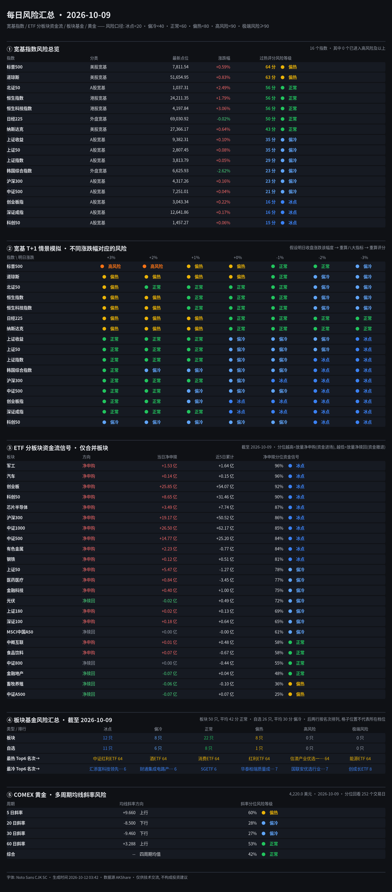

# 每日风险汇总 · 2026-10-15

> 风险口径：`🔵 冰点<20 · 🟦 偏冷<40 · 🟢 正常<60 · 🟡 偏热<80 · 🟠 高风险<90 · 🔴 极端风险≥90`，分位数(0~1)乘 100 后套同一张表。

## ① 宽基指数风险总览

| 指数 | 分类 | 最新点位 | 涨跌幅 | 过热评分 | 风险等级 |
|---|---|---:|---:|---:|---|
| 恒生指数 | 港股宽基 | 24,314.17 | -0.13% | 63 | 🟡 偏热 |
| 道琼斯 | 美股宽基 | 51,621.48 | -0.09% | 56 | 🟢 正常 |
| 恒生科技指数 | 港股宽基 | 4,174.47 | +0.91% | 56 | 🟢 正常 |
| 标普500 | 美股宽基 | 7,718.94 | -1.11% | 44 | 🟢 正常 |
| 纳斯达克 | 美股宽基 | 26,692.87 | -1.88% | 37 | 🟦 偏冷 |
| 北证50 | A股宽基 | 1,002.01 | -0.66% | 25 | 🟦 偏冷 |
| 上证50 | A股宽基 | 2,776.92 | -1.09% | 24 | 🟦 偏冷 |
| 日经225 | 外盘宽基 | 64,449.45 | -4.86% | 23 | 🟦 偏冷 |
| 上证指数 | A股宽基 | 3,767.23 | -0.88% | 22 | 🟦 偏冷 |
| 上证收益 | A股宽基 | 9,244.59 | -1.05% | 16 | 🔵 冰点 |
| 沪深300 | A股宽基 | 4,217.68 | -1.36% | 16 | 🔵 冰点 |
| 中证500 | A股宽基 | 6,980.11 | -1.48% | 15 | 🔵 冰点 |
| 深证成指 | A股宽基 | 12,110.59 | -1.97% | 15 | 🔵 冰点 |
| 科创50 | A股宽基 | 1,380.26 | -3.29% | 8 | 🔵 冰点 |
| 创业板指 | A股宽基 | 2,866.76 | -3.10% | 8 | 🔵 冰点 |
| 韩国综合指数 | 外盘宽基 | 5,574.94 | -7.22% | 3 | 🔵 冰点 |

## ② 宽基 T+1 情景模拟（不同涨跌幅对应的风险）

| 指数 \ 明日涨跌 | +3% | +2% | +1% | +0% | -1% | -2% | -3% |
|---|---|---|---|---|---|---|---|
| 恒生指数 | 🟡 偏热 71 | 🟡 偏热 64 | 🟡 偏热 64 | 🟡 偏热 64 | 🟢 正常 44 | 🟦 偏冷 36 | 🟦 偏冷 28 |
| 道琼斯 | 🟡 偏热 80 | 🟡 偏热 79 | 🟡 偏热 76 | 🟢 正常 44 | 🟢 正常 44 | 🟦 偏冷 29 | 🟦 偏冷 22 |
| 恒生科技指数 | 🟡 偏热 63 | 🟡 偏热 63 | 🟡 偏热 63 | 🟢 正常 56 | 🟢 正常 44 | 🟢 正常 44 | 🟦 偏冷 31 |
| 标普500 | 🟡 偏热 73 | 🟡 偏热 71 | 🟢 正常 56 | 🟦 偏冷 37 | 🟦 偏冷 31 | 🟦 偏冷 21 | 🔵 冰点 19 |
| 纳斯达克 | 🟢 正常 56 | 🟢 正常 56 | 🟦 偏冷 38 | 🟦 偏冷 36 | 🟦 偏冷 23 | 🟦 偏冷 21 | 🟦 偏冷 20 |
| 北证50 | 🟢 正常 56 | 🟢 正常 56 | 🟢 正常 44 | 🟦 偏冷 30 | 🟦 偏冷 23 | 🟦 偏冷 21 | 🟦 偏冷 21 |
| 上证50 | 🟢 正常 56 | 🟢 正常 56 | 🟢 正常 56 | 🟦 偏冷 25 | 🟦 偏冷 21 | 🔵 冰点 14 | 🔵 冰点 13 |
| 日经225 | 🟦 偏冷 37 | 🟦 偏冷 37 | 🟦 偏冷 36 | 🟦 偏冷 35 | 🟦 偏冷 23 | 🟦 偏冷 22 | 🔵 冰点 14 |
| 上证指数 | 🟢 正常 58 | 🟢 正常 58 | 🟢 正常 58 | 🟦 偏冷 23 | 🔵 冰点 15 | 🔵 冰点 14 | 🔵 冰点 13 |
| 上证收益 | 🟢 正常 57 | 🟢 正常 57 | 🟢 正常 58 | 🟦 偏冷 23 | 🔵 冰点 15 | 🔵 冰点 14 | 🔵 冰点 13 |
| 沪深300 | 🟢 正常 58 | 🟢 正常 58 | 🟢 正常 42 | 🔵 冰点 17 | 🔵 冰点 15 | 🔵 冰点 14 | 🔵 冰点 13 |
| 中证500 | 🟢 正常 58 | 🟢 正常 50 | 🟦 偏冷 30 | 🔵 冰点 16 | 🔵 冰点 15 | 🔵 冰点 14 | 🔵 冰点 8 |
| 深证成指 | 🟢 正常 58 | 🟦 偏冷 36 | 🟦 偏冷 30 | 🔵 冰点 16 | 🔵 冰点 15 | 🔵 冰点 14 | 🔵 冰点 8 |
| 科创50 | 🟦 偏冷 30 | 🟦 偏冷 30 | 🔵 冰点 17 | 🔵 冰点 16 | 🔵 冰点 15 | 🔵 冰点 9 | 🔵 冰点 8 |
| 创业板指 | 🟦 偏冷 36 | 🟦 偏冷 30 | 🔵 冰点 17 | 🔵 冰点 16 | 🔵 冰点 15 | 🔵 冰点 8 | 🔵 冰点 7 |
| 韩国综合指数 | 🔵 冰点 8 | 🔵 冰点 7 | 🔵 冰点 6 | 🔵 冰点 5 | 🔵 冰点 5 | 🔵 冰点 4 | 🔵 冰点 4 |

## ③ ETF 分板块资金流信号（仅合并板块，截至 2026-10-14）

> 分位为**带方向**的滚动分位：越接近 100% = 放量净申购（资金进场，偏机会），越接近 0% = 放量净赎回（资金撤退，偏风险）。

| 板块 | 方向 | 当日净申赎(亿元) | 近5日(亿元) | 净申赎分位 | 资金信号 |
|---|---|---:|---:|---:|---|
| MSCI中国A50 | 净申购 | +0.27 | +0.33 | 94% | 🔵 冰点 |
| 中证A500 | 净申购 | +0.14 | +0.14 | 88% | 🔵 冰点 |
| 中证800 | 净申购 | +0.21 | +0.21 | 87% | 🔵 冰点 |
| 创业板 | 净申购 | +19.82 | +82.38 | 86% | 🔵 冰点 |
| 军工 | 净申购 | +0.49 | +2.76 | 76% | 🟦 偏冷 |
| 上证180 | 净申购 | +0.02 | +0.13 | 66% | 🟦 偏冷 |
| 上证50 | 净申购 | +0.49 | +11.11 | 63% | 🟦 偏冷 |
| 科创50 | 净申购 | +2.31 | +17.49 | 63% | 🟦 偏冷 |
| 芯片半导体 | 净申购 | +0.42 | +3.72 | 60% | 🟢 正常 |
| 深证100 | 净申购 | +0.09 | +1.09 | 57% | 🟢 正常 |
| 沪深300 | 净赎回 | -9.47 | +35.27 | 51% | 🟢 正常 |
| 食品饮料 | 净赎回 | -0.07 | +0.59 | 51% | 🟢 正常 |
| 钢铁 | 净赎回 | -0.04 | +0.14 | 47% | 🟢 正常 |
| 医药医疗 | 净赎回 | -0.45 | +1.39 | 47% | 🟢 正常 |
| 汽车 | 净赎回 | +0.00 | +0.19 | 44% | 🟢 正常 |
| 光伏 | 净赎回 | -0.21 | -0.86 | 43% | 🟢 正常 |
| 金融科技 | 净赎回 | -0.18 | +0.83 | 42% | 🟢 正常 |
| 有色金属 | 净赎回 | -0.73 | +0.38 | 38% | 🟡 偏热 |
| 金融地产 | 净赎回 | -0.19 | -0.17 | 35% | 🟡 偏热 |
| 畜牧养殖 | 净赎回 | -0.07 | +0.04 | 34% | 🟡 偏热 |
| 中证500 | 净赎回 | -12.89 | +0.09 | 28% | 🟡 偏热 |
| 中概互联 | 净赎回 | -0.06 | -0.05 | 26% | 🟡 偏热 |
| 中证1000 | 净赎回 | -19.82 | +17.16 | 17% | 🟠 高风险 |

## ④ 板块基金风险汇总（截至 2026-10-14）

| 类型 / 排行 | 🔵 冰点 | 🟦 偏冷 | 🟢 正常 | 🟡 偏热 | 🟠 高风险 | 🔴 极端风险 |
|---|:---:|:---:|:---:|:---:|:---:|:---:|
| **板块** | 21 只 | 7 只 | 14 只 | 7 只 | 1 只 | 0 只 |
| **自选** | 12 只 | 11 只 | 2 只 | 1 只 | 0 只 | 0 只 |
| **最热 Top6（名次 →）** | 1. 红利ETF 84 | 2. 能源ETF 79 | 3. 中证红利ETF 70 | 4. 银行ETF 69 | 5. 标普500ETF 65 | 6. 传媒ETF 64 |
| **最冷 Top6（名次 →）** | 1. 东方阿尔法科技智选混合发起C 7 | 2. 创成长ETF 8 | 3. 华泰柏瑞质量成长C 8 | 4. 芯片ETF 8 | 5. 易方达创业板ETF 8 | 6. 创业板50ETF 8 |

> **板块** 共 50 只，平均 34 分 🟦 偏冷；**自选** 共 26 只，平均 23 分 🟦 偏冷。第一行是六档的只数分布；后两行按名次从左到右排，格子落在哪一列只表示名次，与该列的档位无关。

## ⑤ COMEX 黄金 · 多周期均线斜率风险

最新价：4,153.1 美元 · 2026-10-15

| 周期 | 均线斜率 | 方向 | 斜率分位 | 风险等级 |
|---|---:|---|---:|---|
| 5 日 | -1.000 | 下行 | 47% | 🟢 正常 |
| 20 日 | -11.375 | 下行 | 23% | 🟦 偏冷 |
| 30 日 | -12.227 | 下行 | 20% | 🟦 偏冷 |
| 60 日 | +1.683 | 上行 | 42% | 🟢 正常 |
| 综合 | -- | 四周期均值 | 33% | 🟦 偏冷 |

---
生成时间 2026-10-15 14:16　数据源 AKShare。
本页为技术观察，不构成任何投资建议。