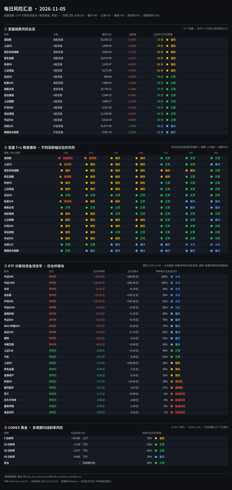

# 每日风险汇总 · 2026-11-13

> 风险口径：`🔵 冰点<20 · 🟦 偏冷<40 · 🟢 正常<60 · 🟡 偏热<80 · 🟠 高风险<90 · 🔴 极端风险≥90`，分位数(0~1)乘 100 后套同一张表。

## ① 宽基指数风险总览

| 指数 | 分类 | 最新点位 | 涨跌幅 | 过热评分 | 风险等级 |
|---|---|---:|---:|---:|---|
| 日经225 | 外盘宽基 | 61,142.35 | +0.53% | 56 | 🟢 正常 |
| 韩国综合指数 | 外盘宽基 | 5,290.53 | -0.98% | 56 | 🟢 正常 |

## ② 宽基 T+1 情景模拟（不同涨跌幅对应的风险）

| 指数 \ 明日涨跌 | +3% | +2% | +1% | +0% | -1% | -2% | -3% |
|---|---|---|---|---|---|---|---|
| 日经225 | 🟡 偏热 63 | 🟡 偏热 63 | 🟡 偏热 63 | 🟢 正常 56 | 🟢 正常 44 | 🟢 正常 44 | 🟢 正常 44 |
| 韩国综合指数 | 🟢 正常 56 | 🟢 正常 56 | 🟢 正常 56 | 🟢 正常 44 | 🟢 正常 44 | 🟢 正常 44 | 🟦 偏冷 38 |

## ⑥ 数据健康度

- 宽基 sh000001 无行情
- 宽基 sh000688 无行情
- 宽基 bj899050 无行情
- 宽基 sh000010 无行情
- 宽基 .IXIC 无行情
- 宽基 .INX 无行情
- 宽基 .DJI 无行情
- 宽基 hkHSI 无行情
- 宽基 hkHSTECH 无行情
- 宽基 sz399006 无行情
- 宽基 sh000016 无行情
- 宽基 sh000300 无行情
- 宽基 sh000905 无行情
- 宽基 sz399001 无行情
- ETF: 未找到 etf_flow.parquet, 资金流板块跳过
- 基金: 缺 fund_nav_history.csv 或 funds_universe_example.csv
- 黄金: 取数失败(AttributeError)

---
生成时间 2026-11-15 04:02　数据源 AKShare。
本页为技术观察，不构成任何投资建议。