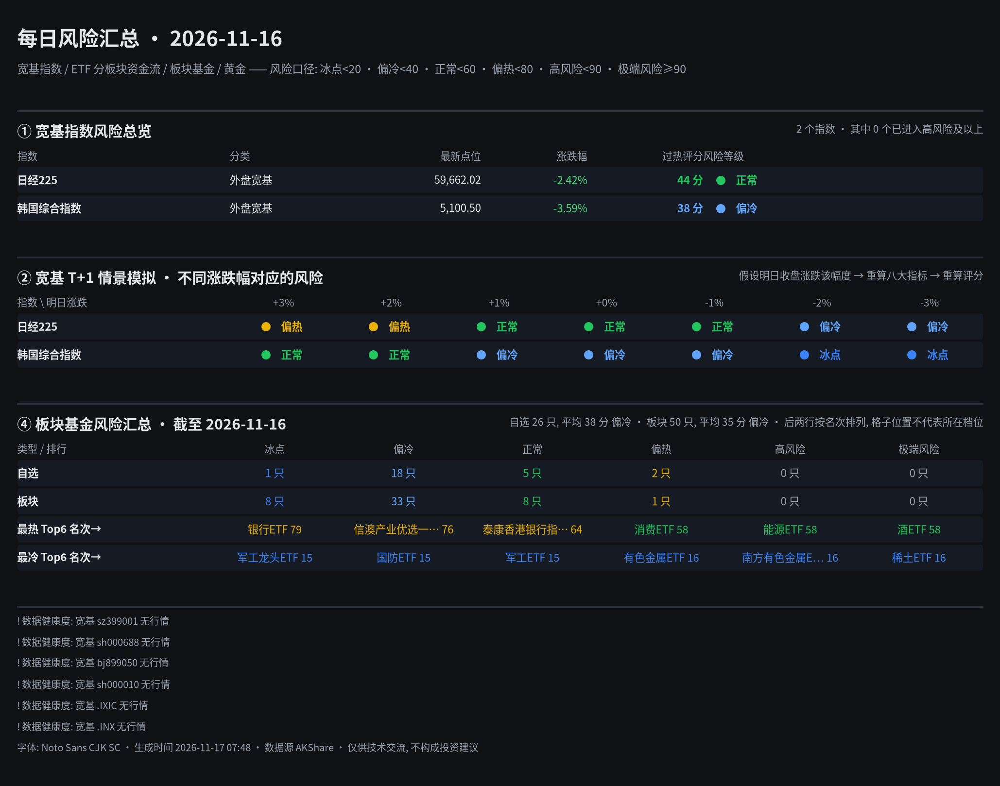

# 每日风险汇总 · 2026-11-20

> 风险口径：`🔵 冰点<20 · 🟦 偏冷<40 · 🟢 正常<60 · 🟡 偏热<80 · 🟠 高风险<90 · 🔴 极端风险≥90`，分位数(0~1)乘 100 后套同一张表。

## ① 宽基指数风险总览

| 指数 | 分类 | 最新点位 | 涨跌幅 | 过热评分 | 风险等级 |
|---|---|---:|---:|---:|---|
| 韩国综合指数 | 外盘宽基 | 4,869.96 | -5.21% | 32 | 🟦 偏冷 |
| 日经225 | 外盘宽基 | 56,436.65 | -5.06% | 12 | 🔵 冰点 |

## ② 宽基 T+1 情景模拟（不同涨跌幅对应的风险）

| 指数 \ 明日涨跌 | +3% | +2% | +1% | +0% | -1% | -2% | -3% |
|---|---|---|---|---|---|---|---|
| 韩国综合指数 | 🟢 正常 56 | 🟢 正常 44 | 🟦 偏冷 38 | 🟦 偏冷 31 | 🟦 偏冷 31 | 🟦 偏冷 25 | 🔵 冰点 19 |
| 日经225 | 🟢 正常 44 | 🟦 偏冷 38 | 🟦 偏冷 37 | 🟦 偏冷 24 | 🔵 冰点 11 | 🔵 冰点 10 | 🔵 冰点 8 |

## ④ 板块基金风险汇总（截至 2026-11-19）

| 类型 / 排行 | 🔵 冰点 | 🟦 偏冷 | 🟢 正常 | 🟡 偏热 | 🟠 高风险 | 🔴 极端风险 |
|---|:---:|:---:|:---:|:---:|:---:|:---:|
| **板块** | 9 只 | 29 只 | 9 只 | 3 只 | 0 只 | 0 只 |
| **自选** | 5 只 | 16 只 | 4 只 | 1 只 | 0 只 | 0 只 |
| **最热 Top6（名次 →）** | 1. 银行ETF 70 | 2. 信澳产业优选一年持有混合C 65 | 3. 红利ETF 63 | 4. 消费ETF 63 | 5. 科创50ETF 56 | 6. 芯片ETF 56 |
| **最冷 Top6（名次 →）** | 1. 军工龙头ETF 12 | 2. 国防ETF 13 | 3. 游戏ETF 13 | 4. 恒生互联网ETF 14 | 5. 传媒ETF 14 | 6. 鹏华创新未来混合(LOF)C 15 |

> **板块** 共 50 只，平均 34 分 🟦 偏冷；**自选** 共 26 只，平均 33 分 🟦 偏冷。第一行是六档的只数分布；后两行按名次从左到右排，格子落在哪一列只表示名次，与该列的档位无关。

## ⑥ 数据健康度

- 宽基 sh000001 无行情
- 宽基 sh000688 无行情
- 宽基 bj899050 无行情
- 宽基 sh000010 无行情
- 宽基 .IXIC 无行情
- 宽基 .INX 无行情
- 宽基 .DJI 无行情
- 宽基 hkHSI 无行情
- 宽基 hkHSTECH 无行情
- 宽基 sh000300 无行情
- 宽基 sz399001 无行情
- 宽基 sz399006 无行情
- 宽基 sh000016 无行情
- 宽基 sh000905 无行情
- ETF: 未找到 etf_flow.parquet, 资金流板块跳过
- 黄金: 取数失败(AttributeError)

---
生成时间 2026-11-20 16:39　数据源 AKShare。
本页为技术观察，不构成任何投资建议。